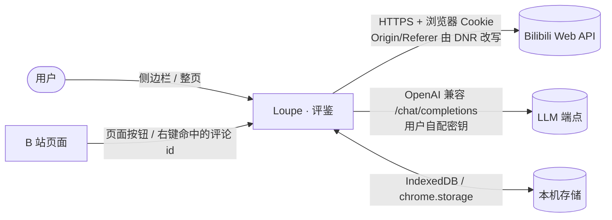

# 01 上下文（arc42 §3）

Loupe · 评鉴是一个 Chrome MV3 扩展：在用户自己的浏览器身份下抓取社交平台评论，本地完成建树、统计、可视化，可选调用用户自备的大模型做解读。没有后端服务。

| 外部实体 | 方向 | 接口 | 说明 |
|---|---|---|---|
| Bilibili Web API `api.bilibili.com` | 出 | HTTPS JSON；WBI 签名；Cookie 随请求（`credentials: include`） | `nav`（登录态 + WBI 密钥）、`web-interface/view`（视频元数据）、`v2/reply/wbi/main`（顶层评论，按时间游标）、`v2/reply/detail`（评论树，游标，匿名可完整翻页）。扩展发出的请求带 `Origin: chrome-extension://…` 会被 412 风控，后台用 declarativeNetRequest 会话规则改写 Origin/Referer，仅作用于扩展自身发起的请求。 |
| B 站页面（`www.bilibili.com`） | 入 | 内容脚本（主世界 + 隔离世界）→ `runtime.sendMessage` | 在播放器下方工具栏操作行与每条评论的操作行里注入一键分析按钮（点击在手势里同步上报，站点 hydration 完成后才注入），以及右键命中的评论 id；不抓 DOM 数据。 |
| LLM 端点（用户配置） | 出 | OpenAI 兼容 `POST {baseUrl}/chat/completions`，SSE 流式 | 可选；密钥存 `chrome.storage.local`，运行时按需申请该源的可选主机权限。 |
| 本机存储 | 双向 | IndexedDB（缓存、快照）、`chrome.storage.local`（设置）、`chrome.storage.session`（意图、右键评论） | 缓存只是优化：IndexedDB 不可用时降级为内存 + 回源。 |

不在边界内：账号登录流程本身（交给 B 站官方登录页）、跨设备同步、服务端存档。
