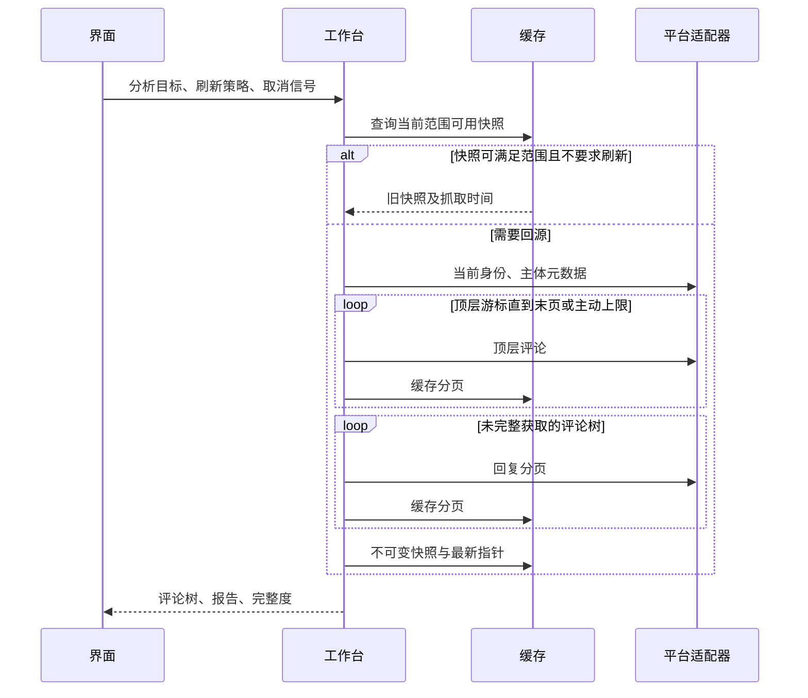

# 03 构件与运行时（arc42 §5 §6 §8）

| 构件 | 文件 | 职责与边界 |
|---|---|---|
| 扩展宿主 | `src/extension/` | MV3 清单、工具栏弹窗、页面内联按钮与右键菜单、受限请求头规则；不保存登录 Cookie |
| 平台接缝 | `src/core/model.ts`、`platform.ts`、`errors.ts` | 统一主体、评论、分页、错误与可选写能力（点赞 / 回复）；评论 ID 始终为字符串 |
| Bilibili | `src/platforms/bilibili/` | URL 解析、WBI 签名、平台响应校验、评论归一化、评论写接口（`/x/v2/reply/action`、`/x/v2/reply/add`） |
| 工作台 | `src/core/workbench.ts`、`crawl.ts` | 任务范围、分页调度、取消、进度、快照复用 |
| 缓存 | `src/core/cache/` | 内存 LRU + IndexedDB、TTL、同键请求合并、磁盘淘汰、失败降级；页面上下文用纯内存实现（`createMemoryCache`，绝不写页面源的 IndexedDB） |
| 分析 | `src/core/tree.ts`、`analysis.ts` | 父子拓扑、作者互动、时间分布、关键词与排行榜 |
| AI | `src/ai/` | 摘录预算、引用、流式协议、结构化诊断与结果缓存 |
| 界面 | `src/ui/` | Vue 状态、整页工作台、放大镜打开的满窗图谱窗口、工具栏配置弹窗、可选页面树形阅读器；共用安全正文/表情渲染 |

## 抓取与复用

单评论分析先确定所在平台楼层，必要时遍历楼层回复，再按 parent 链筛出选中评论的后代。祖先与兄弟分支不计入目标统计。父评论缺失时保留原始 parentId/rootId，不虚构文本。

## 缓存与一致性

键携带 schema 版本（当前 v4）。TTL 分级并抖动：签名/登录态 30 分钟、元数据 10 分钟、分页 30 分钟、**已固化的历史区间 12 小时**（时间序首屏仍 30 分钟、更深页给 12 小时；热度序的块一直 12 小时，链记录只在走完后才给 12 小时）；不可变快照与内容寻址 AI 结果由存储预算淘汰。最新指针只是索引，不是事实来源。页键按账号（u:<mid>/anon）+ 顶层排序（time/hot）隔离，热度序再按「平台会话 + 块号」成链（`crawl.ts#loadHotRootsPage`：`mode=3` 是平台侧有状态分页，游标 `hot:<会话 id>:<块号>`，整链回放 0 回源），seek 定位块走独立 'seek' 键；session 与登录态 nav 再带身份姿态维度（direct/page）——因此工作台与嵌入阅读器可以共用同一份 IndexedDB 而不互喂错身份，跨文档同键单飞由 Web Locks 串行化（拿锁复读，loader 只跑一次）。手动检查身份不能被长期登录态缓存挡住。

增量只根据平台回复数判断是否需要重抓一棵树，无法发现同数量的替换、编辑或点赞更新。完整刷新用于这类精确更新。缓存写入失败不让已完成的数据获取变成失败，缓存统计记录降级。

## 图谱与网页阅读是两个界面

- `ForceGraph` 使用 d3-force，节点是评论而非作者聚合，边来自 parent 关系；布局不能写回领域树。Canvas 位图与 CSS 尺寸隔离，模拟停止及组件卸载必须释放计时器。
- 页面级设置存 `chrome.storage.local`、在工具栏弹窗（`action.default_popup` = `src/ui/config.html`，紧凑配置，不含工作台导航/分析输入/报告/AI）里编辑；面板只有两项：页面开关 `loupe.pageComments.enabled` 与主题配色 `loupe.palette`（后者见 ADR-0007 与 `src/ui/theme.ts`）：
  - `loupe.pageComments.enabled` 默认关闭，驱动的是**原生评论区替换**（隔离世界 `content/isolated.ts` 启动 `content/page-reader.ts`）：视频页上隐藏原生评论根（只写它的 `display` 并保存原值，绝不碰 `#biliMainHeader` 与评论区的任何祖先），并在原生根原位插入相邻的自绘阅读器 iframe 槽位；关闭、离开视频页或原生评论根消失即撤掉槽位并精确还原。原生根只在阅读器发来 `reader-ready`（UI 已挂载）后才隐藏——抓取期间用户先看到进度，失败时原生评论仍在。
  - 原生样式增强那两个主世界模块**保留但未接线**：页面开关不再驱动它们，主世界也不再启动它们（`tmp/preview.ts` 仍在用这套模块做可复现预览）：
    - `content/native-comments-style.ts`：把一张样式表注入 `bili-comments` 评论区下的每个 open shadow root，覆盖正文、作者行、操作区、回复层级与分支边界。只改样式——不隐藏原生节点、不改原生 DOM 事件、不调用平台写接口；点赞/回复/发布/排序/加载更多保持原生可用。
    - `content/native-thread.ts`（关系算法是纯逻辑 `content/native-thread-layout.ts`，不碰 DOM，可给别的评论模型复用）：站点把一条楼中楼平铺在 `bili-comment-replies-renderer` 里（容器靠**结构探测**找：「直接子元素里至少有一个 `bili-comment-reply-renderer`」的那个元素，实机是 `#expander-contents`，**不认这个易变 id**；容器里的非回复子元素如 `#expander-footer` 不排、不隐藏、不写自有属性，只靠样式表 `order` 让位给回复），层级只在组件数据（`__data`/`.data` 的 `rpid_str`/`parent_str`）里；这里按**已加载**父链算出父先子后前序，用 CSS `order` 在原容器内做视觉重排（DOM 不移动）、按层级做封顶缩进，并给有已加载后代的评论在其操作行里挂一个折叠控件（`title`/`aria-label`/`aria-expanded` + Phosphor caret 图标）：点击只隐藏已加载后代（保留节点），折叠状态按评论 id 记、同线程后加载的回复继承，关闭开关逐条还原（内联变量回原值、自有属性摘掉、控件移除、样式表摘除）。父 id 缺失/为 0/不在已加载列表里时该条显示在当前顶层并就地说明「父评论未加载」；容器结构不符合预期（直接子元素里一条 reply renderer 都找不出来、某条读不到 rpid、rpid 重复、根评论数据缺失）时整容器/整线程跳过，不排、不缩进、不折叠、不隐藏。
  - 评论行放大镜（「分析评论树」）的注入**不按评论量判定**：主世界扫描原生评论操作行，只要能解析出 rpid 就注入（`content/injector.ts` 的 `scanArea`），评论数与回复数都不参与显隐；视频级「分析评论区」按钮同样不受数量控制。按钮的展示形态（原生行注入、自绘行入口）见下文「图谱与网页阅读」一节。
- 页面开关由隔离世界（`content/isolated.ts`）读取 `chrome.storage.local` 后启动/停止 `content/page-reader.ts`——主世界读不到 `chrome.storage`，只负责注入；主题配色同理：工作台/设置弹窗改 `loupe.palette`，各文档自己跟随（见 ADR-0007）。原生样式增强的注入仍幂等且可撤销：同一张 `CSSStyleSheet` 实例最多在每个 root 的 `adoptedStyleSheets` 里出现一次，关闭或 dispose 即从所有 root 摘除，原有样式表不动；shadow root 或 `bili-comments` 整块重建后重新注入，旧 root 在 sweep 里恢复默认。颜色只取站点 CSS 变量并给兜底值，明暗随站点主题。（`NATIVE_STYLE_BRIDGE_SOURCE` 是上面那套未接线模块自己的契约，隔离世界已不再推它。）
- 嵌入阅读器（`content/page-reader.ts` + 扩展内嵌页 `src/ui/EmbeddedComments.vue`）是页面开关开启后的自维护评论区：只在原生评论根后插入相邻 iframe 槽位、只对原生评论根写 `display`，iframe 通过后台取得发送标签页的可信视频 URL，不接受网页传来的任意分析地址；高度、滚动与明暗仍由宿主经桥告知。评论的多级关系由阅读器自己按 `rootId`/`parentId` 搭成森林（不依赖原生分页按钮），抓取走 `previewRootsPage`（按游标逐页）与 `previewThread`（按需回复树）。写操作只发意图：iframe 发 `READER_WRITE_REQUEST`（点赞 / 取消点赞 / 回复 / 发表顶层评论，`reply` 的 `rootId` 与 `parentId` 必须成对），内容脚本在页面上下文里执行后按 `requestId` 回投 `READER_WRITE_RESULT`（成功回复带归一化评论）；CSRF 只在写执行点从 cookie 现读现用，绝不跨桥进消息、日志、快照或错误文本。读取同理，只是方向相反：评论分页 / 评论树的 GET 由 iframe 发 `READER_FETCH_REQUEST`（只放行 `https://api.bilibili.com` 的 https 地址），内容脚本在页面上下文（同站、带 Cookie）执行后按 `requestId` 回投 `READER_FETCH_RESULT`（解析后的 JSON，或错误类别 + 文案）——扩展源直连带不上站点 Cookie，会被平台按匿名身份截断（顶层评论约 315 条就停），页面上下文读到的才是原生那份全量，WBI 签名仍由 iframe 侧算好；桥不可用（不在嵌入页里 / 内容脚本没回话）时退回扩展源直连（匿名），不硬失败。
- 阅读器分页是**游标状态机**（`src/ui/infinite-scroll.ts` + 抓取层 `previewRootsPage` → `crawlRootsPage`）：一页 = 平台分页的一次请求（含该页根评论的楼中楼预览），数据只追加、同 id 覆盖原位；「到底」只认平台给的下一个游标（`next === null`）——不由「请求 N 条拿到更少」推断，到底之后不再发请求。取数守卫只有一处：`hasNext && !loading`，同一时刻至多一次在途；失败保留游标，重试从同一页继续，绝不重放整条链（与整链抓取共用同一套页缓存键与账号隔离，翻回已读过的页不再打平台）。展开某条评论时才按需抓它的回复树（单树有上限）；预览抓取不落快照（不写最新指针与历史）。写结果的落地方式分两类：点赞先乐观点亮、失败回滚并提示；回复与发表成功把返回的评论并进树（新顶层评论钉在列表最上面，同一条评论在列表里只出现一次），失败留下草稿并就地提示。全量分析只在放大镜打开的独立窗口里做。该窗口（`?view=graph&input=&comment=`）只渲染一张铺满窗口的力导向图，没有顶栏、输入、视图切换与常驻详情栏，评论正文在图上悬停查看；它也不参与工作台的意图分发。阅读器每一行的「图谱」入口总是渲染，默认隐于行右端（`opacity: 0`），鼠标悬停该行或该行被选中才显现——入口不占版面，也不与操作行的其余按钮抢宽度。
- 滚动与明暗都交给宿主：iframe 高度跟随内容高度（页面只有一根滚动条，长正文按自然高度完整呈现），主题经桥取宿主明暗后落到 `<html data-theme>`；底色也不自己画——iframe 与阅读器根元素都透明，B 站评论区自己的底色直接透上来，浅色/深色/站点以后换主题都与站点同色。槽位只与原生评论区相邻，绝不触碰评论区的祖先与站点页头。触发与高度各有一条结构性约束，针对的都是同一个闭环——内容变矮 → 宿主文档变矮 → 浏览器把 `scrollTop` 钳回（观感即回弹）：
  - **触发 = 宿主视口消息 + 边沿闸门**（`READER_VIEWPORT{visibleBottom}` → `evaluateTrigger`）：同一段「到底区」只触发一次取数，离开到底区重新武装，取数落定后再评估一次（人还停在底部就继续取下一页，重复由状态机的 `hasNext`/`loading` 拦下）。列表末尾的哨兵 + `IntersectionObserver`（implicit root；提前量用 `translateY` 做进哨兵自身几何——跨源目标上 `rootMargin` 会被忽略）只是兜底触发，不是正确性的唯一依赖。
  - **已提交高度不缩**：高度只在 DOM 更新之后（`nextTick`）显式测量，只增不减——只有折叠切换、换目标/重置这类结构性缩高事件才允许提交更小的值，同一个值不重复上报；`ResizeObserver` 只作图片 / 头像落定之后的补报。
  - 渲染上限（`rowCap`，首批 100 行）只增不减、已渲染行不回收；页脚用 `min-height` 钉住，于是「继续显示 / 加载中 / 已到底 / 失败重试」之间切换不改变内容高度。
  - 三条被取代的旧写法（同一份契约的反面）：用固定像素阈值判定「快到底」；每次「加载更多」把上限加一页并**重跑整条游标链、整体替换结果**；用「行数没减少时高度只增不减」的事后补丁遮盖抖动。分别换成哨兵/边沿闸门、逐页追加、按结构事件判定的高度下界。
- 图片表情保留 token→CDN 图片映射，Unicode emoji 保留原文；渲染不使用 innerHTML。表情 URL 限定 Bilibili CDN，失败还原 token，缓存 schema 升级触发重新抓取而非凭空补全旧数据。
- 两个入口都不依赖用户激活：视频级入口用 `chrome.tabs.create` 开完整工作台（`?view=tab&input=&comment=`），评论行放大镜用 `chrome.windows.create({ type: 'popup' })` 开图谱窗口（`?view=graph&input=&comment=`）——图谱窗口初始 960×660、以当前窗口中心摆位，挂载后**首帧就按内容包围盒量一次**尺寸（不等仿真收敛），仿真收敛后再校准一次，尺寸夹在工作区与 720×560…1500×1100 之间，用户自己拖过/改过窗口就彻底不抢。落地面由后台按消息 kind 决定，分析目标只取 sender 标签页的当前地址（与消息里的 pageUrl 归一化后一致才认），评论 id 必须是纯数字；打开失败就地显示后台给出的原因，不降级到别的界面，也不能只打日志后丢弃点击。

## 安全与失败

平台数据、评论文本和模型输出都是不可信输入。扩展不执行评论或模型提供的指令；Markdown 通过安全组件渲染，不直接插入 HTML。凭据不进入提示词、缓存键或报告。扩展加载先确认后台请求头规则安装成功，再开始网络请求。

风险限制与网络错误采用有界退避；取消信号贯穿排队、等待和 fetch。用户取消或抓取出错不得生成“完成”的假快照。平台声明量与实际量不一致时保留原因，不能补齐虚构评论。
