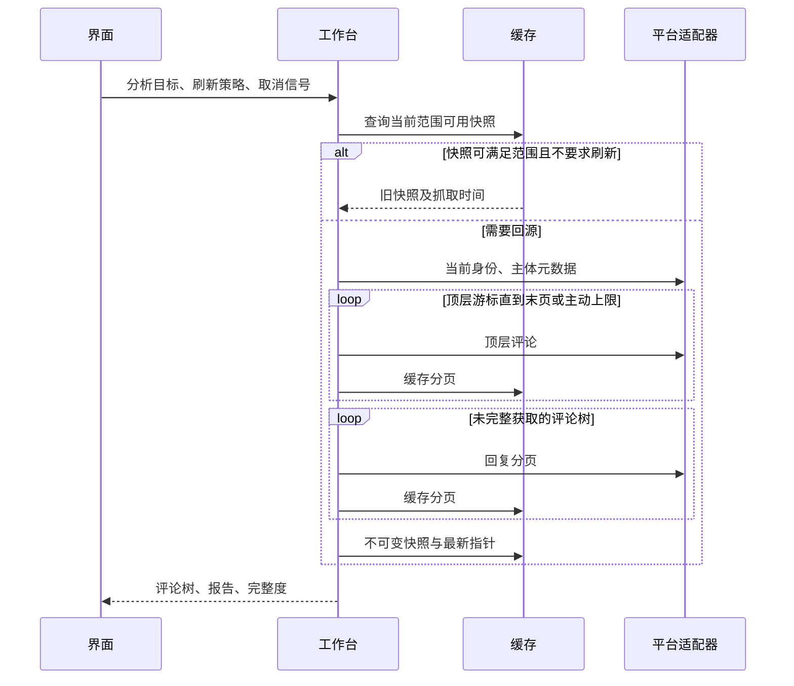

# 03 构件与运行时（arc42 §5 §6 §8）

| 构件 | 文件 | 职责与边界 |
|---|---|---|
| 扩展宿主 | `src/extension/` | MV3 清单、侧栏、页面内联按钮与右键意图、受限请求头规则；不保存登录 Cookie |
| 平台接缝 | `src/core/model.ts`、`platform.ts`、`errors.ts` | 统一主体、评论、分页、错误；评论 ID 始终为字符串 |
| Bilibili | `src/platforms/bilibili/` | URL 解析、WBI 签名、平台响应校验、评论归一化 |
| 工作台 | `src/core/workbench.ts`、`crawl.ts` | 任务范围、分页调度、取消、进度、快照复用 |
| 缓存 | `src/core/cache/` | 内存 LRU + IndexedDB、TTL、同键请求合并、磁盘淘汰、失败降级 |
| 分析 | `src/core/tree.ts`、`analysis.ts` | 父子拓扑、作者互动、时间分布、关键词与排行榜 |
| AI | `src/ai/` | 摘录预算、引用、流式协议、结构化诊断与结果缓存 |
| 界面 | `src/ui/` | Vue 状态、侧栏/整页、Canvas 树、虚拟列表；通过工作台调用平台能力 |

## 抓取与复用

单评论分析先确定所在平台楼层，必要时遍历楼层回复，再按 parent 链筛出选中评论的后代。祖先与兄弟分支不计入目标统计。父评论缺失时保留原始 parentId/rootId，不虚构文本。

## 缓存与一致性

键携带 schema 版本。元数据与分页 TTL 为 10 分钟并抖动；签名材料单独缓存；不可变快照与内容寻址 AI 结果由存储预算淘汰。最新指针只是索引，不是事实来源。登录身份敏感的分页不得跨账户共享；手动检查身份不能被长期登录态缓存挡住。

增量只根据平台回复数判断是否需要重抓一棵树，无法发现同数量的替换、编辑或点赞更新。完整刷新用于这类精确更新。缓存写入失败不让已完成的数据获取变成失败，缓存统计记录降级。

## 安全与失败

平台数据、评论文本和模型输出都是不可信输入。扩展不执行评论或模型提供的指令；Markdown 通过安全组件渲染，不直接插入 HTML。凭据不进入提示词、缓存键或报告。扩展加载先确认后台请求头规则安装成功，再开始网络请求。

风险限制与网络错误采用有界退避；取消信号贯穿排队、等待和 fetch。用户取消或抓取出错不得生成“完成”的假快照。平台声明量与实际量不一致时保留原因，不能补齐虚构评论。
