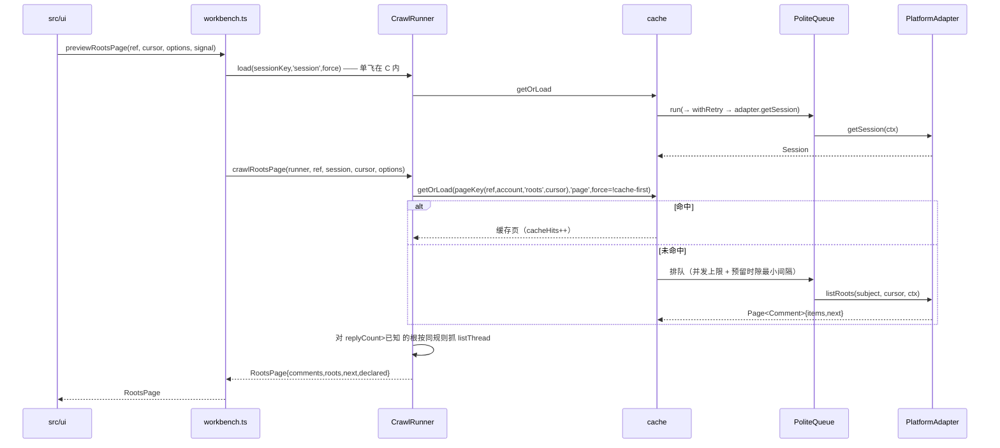
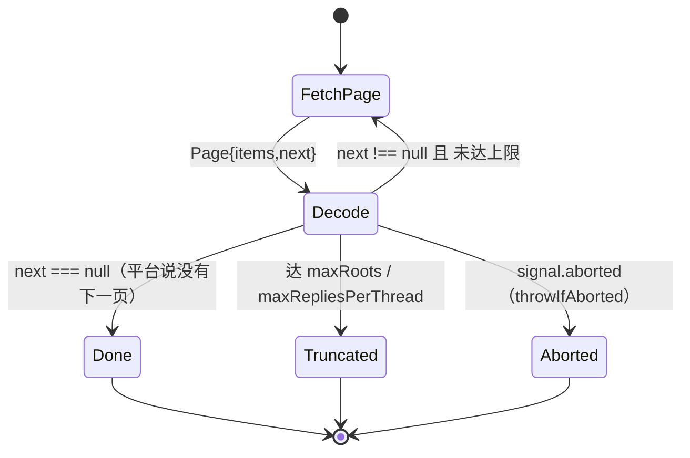

# core（L2 上下文）

> 评论抓取与分析引擎：把适配器归一化的评论抓全、缓存、搭树、算报告，向 UI 暴露一个门面对象。

## 职责边界

**做**：平台无关的抓取编排（游标分页 / 礼貌队列 / 重试 / 取消 / 进度，`crawl.ts`）；快照生命周期与报告装配（`workbench.ts`、`report.ts`、`analysis.ts`）；评论树拓扑（`tree.ts`）；两级缓存与降级（`cache/`）；领域模型与接缝（`model.ts`、`platform.ts`、`errors.ts`、`http.ts`）。

**不做**：
- 不认任何平台原始字段：URL 解析、WBI 签名、响应校验全在 `src/platforms/*`（`model.ts:2-4`）。
- 不渲染、不持 UI 状态（`src/ui/`）；不读 cookie、不拼 csrf——写凭据由调用方现读传入（`platform.ts:57-59`）。

## 对外接口

唯一构造入口 `createWorkbench(deps: WorkbenchDeps): Workbench`（`workbench.ts#createWorkbench`）；`deps = {adapters, cache, http, now?, sleep?}`（`workbench.ts#WorkbenchDeps`）。UI 只依赖 `report.ts` + `model.ts`。

`Workbench`（契约 `report.ts#Workbench`，实现见 `workbench.ts`）：

| 成员 | 要点 | 结果 |
|---|---|---|
| `resolve(input)` | 依次试各适配器 `parseTarget`，都不认返回 `null`（`workbench.ts:347`） | `{adapter,target} \| null` |
| `session(platform, signal?)` | **每次 force 回源**，不吃 30 分钟 session 缓存（`workbench.ts#session`） | `Session` |
| `analyzeSubject(ref, options, onProgress, signal)` | 落快照（`workbench.ts:364`） | `AnalysisResult<SubjectReport>` |
| `analyzeThread(ref, commentId, …)` | 落快照；cache-first 下可由主体快照派生（`workbench.ts:368`，派生见 `workbench.ts:450`） | `AnalysisResult<ThreadReport>` |
| `previewSubject(ref, options, …)` | 只算不存；整链重跑一遍（`workbench.ts:373`） | 同上 |
| `previewRootsPage(ref, cursor, options, …)` | 只算不存；按游标取**一页**（`workbench.ts:378`） | `RootsPage` |
| `previewThread(ref, commentId, …)` | 只算不存（`workbench.ts:382`） | `AnalysisResult<ThreadReport>` |
| `locateComment(ref, commentId, …)` | 定点定位：快照已含零请求，否则 `seekRoot` 一次取回（`'seek'` 页键）（`workbench.ts#runLocate`） | `LocatedComment` |
| `history()` / `openSnapshot(id)` / `deleteSnapshot(id)` | 索引读写（`workbench.ts:386/397/409`）；`openSnapshot` 缺快照抛 `PlatformError('not-found')` | `SnapshotSummary[]` / `AnalysisResult<…>` |
| `clearCache()` / `cacheStats()` / `cacheUsage()` | 透传缓存（`workbench.ts:431-435`） | — |

调用方拿到的是 `AnalysisResult<R> = {snapshot, forest, report, fromSnapshot}`（`report.ts:211-216`）：**已搭好的森林 + 已算好的报告 + 完整度**，UI 不再自己遍历评论（`src/ui/store.ts:147,191,221`）。领域模型里作者带 `Author.profileUrl?`（适配器归一化时给出主页地址，UI 只负责渲染成链接，不自己拼平台 URL；平台没给就省略，界面退化成纯展示）。逐页入口拿 `RootsPage{comments,roots,next,declared,limitations}`（`report.ts:225-238`；`src/ui/EmbeddedComments.vue#fetchPage`）——其中 `limitations` 是本次读取的**身份限制**（如未登录会被平台截断成几条并直接说 `is_end`，见 `src/platforms/bilibili/api.ts#ANONYMOUS_LIMITATION`），阅读器把它写进完整度原因，用户才看得到「为什么只有这几条」。

其余导出：`report.ts` 类型全集（`Snapshot`/`Completeness`/`CrawlCaps`/`FetchStats`/`Forest`/`SubjectReport`/`ThreadReport`/`CrawlOptions`/`RefreshMode`/`CrawlProgress`/`SNAPSHOT_SCHEMA=2`）；纯函数 `analyzeSubject`、`analyzeThread`（`analysis.ts:227,245`，后者缺分析根抛 `not-found`）、`buildForest`（`tree.ts:10`）；缓存构造 `createCache`（`cache/index.ts:21`，内存 LRU + IndexedDB）与 `createMemoryCache`（`cache/memory.ts:61`，页面上下文用，绝不写页面源 IndexedDB）；`createHttpClient`（`http.ts:23`）；`PlatformError`/`isPlatformErrorKind`/`isAbort`（`errors.ts:43,37,69`）。

## 依赖关系

- 依赖：`model.ts`（领域类型）、`platform.ts`（适配器接口 + `HttpClient`）、`errors.ts`、`cache/types.ts`（键与新鲜度）、`cache/`（存储）、`http.ts`（传输）。
- 被依赖：`src/ui/services.ts:17,31` 用 `createWorkbench` 建两个门面（整页用磁盘缓存、阅读器用内存缓存）；`src/ui/store.ts`、`EmbeddedComments.vue` 只经门面取数；`src/ai/` 消费 `Snapshot`；`src/platforms/*` 实现 `PlatformAdapter` 并归一化到 `model.ts` 类型。

## 关键决策（为何这样设计）

- **写能力**：`PlatformWrites` = `likeComment` / `dislikeComment`（hate 端点）/ `deleteComment` / `replyComment`（`platform.ts`）；`Comment` 正文引用字段 `mentions` / `jumps` 与视角态 `disliked` 由适配器归一化（`model.ts`）。
- **TTL 分层**：`Freshness` 里 `page`=30 分钟、`history`=12 小时。顶层/回复分页都是**首屏 `page`、更深页 `history`**（新内容只进顶部），热度序块一律 `history`、链记录见下条。
- **页缓存键 = 账号 + 排序 + 定位三维**：键 = `cacheKey('page', subjectKey(ref), account, 'roots'|'thread', …)`（`crawl.ts#crawlSubject`、`crawl.ts#crawlRootsPage`、`crawl.ts#crawlThreadPages`），`account = loggedIn ? 'u:<id>' : 'anon'`。roots 页键在 cursor 前再带一个 `order` 段（`'time'`/`'hot'`，`report.ts#rootOrderOf` 缺省 `'time'`）：两种排序各自成链，互不共吃缓存。
- **热度序的键是「会话 + 块号」而不是 offset**：`mode=3` 是平台侧有状态分页（同一 offset 连发多次会逐块推进，`offset=""` 才开新会话），游标因此由我们编成 `hot:<会话 id>:<块号>`，块键 `cacheKey('page', subject, account, 'roots', 'hot', chainId, index)`、链记录 `cacheKey('pointer', 'roots-hot-chain', subject, account)`（`chainId`/`next`/`chunks`/`ended`/`firstIds`）。回放与续块都在这条链上做（`crawl.ts#loadHotRootsPage`），`time` 序仍按游标直接缓存。**会话活不过 20 分钟**（实测隔 20 分钟用旧 offset 续会回放中间某块），所以续块时新页与链里已收条目**任一 id 重合**即判重置：开新会话并快进跳过重合块（≤3 块），耗尽则带 `endReason` 收尾；未走完的链记录只给 30 分钟寿命，走完的给 12 小时。整段取数在 `loupe-hot|<subject>|<account>` 的 Web Lock 里串行，两个标签页不会互相覆盖链指针。
- **定位读取走 `'seek'` 键**（`cacheKey('page', subjectKey(ref), account, 'seek', commentId)`），刻意不写成 `'roots|start'`——定位块不是第一页。
- **session/nav 键带身份姿态**：`cacheKey('session', adapter.id, identity)`（`workbench.ts#loadSession`、`#session`、`#canReuseSnapshot`）与 `cacheKey('bilibili','nav', ctx.identity)`（`api.ts#loadNavData`），`identity` 来自 `HttpClient.identity`（`'direct'`/ `'page'`，`platform.ts#HttpClient`），经 `CrawlRunner.request` 注入 `FetchContext.identity`。同一份物理缓存下页面桥与扩展源直连各读各的登录态；WBI 密钥与身份无关，键保持全局。
- **`next === null` 是「到底」的唯一权威判据**：否掉了「请求 N 条只回更少 = 没有下一页」的客户端算术推断——平台截断与真到底不可区分（`report.ts:222-224`；ADR-0003）。
- **`crawlRootsPage` 只取一页**：否掉了「把上限加一页、从起点重跑整条游标链再整体替换」的旧写法；逐页追加、翻回已读页直接吃缓存（`crawl.ts:432-438`；ADR-0003）。
- **`refresh` 三档各管一段**：`cache-first` 先试快照再吃分页缓存；`incremental`/`full` 顶层分页一律 `force` 回源，只有 `incremental` 额外复用「replyCount 未变且旧快照已抓全」的子树（`crawl.ts:307-308,351-370`；`report.ts:187-193`）。
- **预览不落快照**：`preview*` 传 `persist=false`（`workbench.ts:373-384`）——首屏预览天然截断，写成 latest 会污染 cache-first 复用与历史（`workbench.ts:171-174`）。
- **快照复用看「上限覆盖 + 登录态不弱于」**：`canReuseSnapshot`（`workbench.ts:132-145`）——未截断直接可用；已截断要求旧 `caps` 覆盖本次上限（0 = 不限视为已取尽），且匿名快照不得在已登录时复用。
- **`force` 只在回源档位出现**：`LoadOptions.force`（`cache/types.ts:51-53`）由 `{force: !usePageCache}` 传入分页（`crawl.ts:322,460,550`），meta 用 `{force: refresh === 'full'}`（`crawl.ts:303`）。
- **单飞在缓存层，不在抓取层**：`getOrLoad` 的 `inflight` 表保证同键并发只跑一次 loader（`cache/index.ts#getOrLoad`；内存版同形 `memory.ts`）。跨文档再来一层：`CreateCacheOptions.locks`（默认 `navigator.locks`，`null` 关闭）把同键加载串行化到 Web Locks 里——拿到锁先复读一次，另一个文档刚写完的值按磁盘命中返回，loader 全链路只跑一次（实测：扩展源 iframe 与顶层扩展页共享同一份 IndexedDB 与锁空间）。锁设施故障降级为无锁回源；loader 抛错照旧透传不写缓存。
- **缓存故障绝不阻断分析**：存储层只提供速度——读写异常一律 `degraded++` 并当作未命中/静默失败，只有 loader 自身错误透传且不写缓存（`cache/index.ts:17-19,60-63,111-113`；`cache/types.ts:1-8`）。
- **礼貌 = 并发名额 + 共享令牌桶**：`PoliteQueue` 只做同文档并发上限（名额先占后用、释放转让给队首，`crawl.ts#PoliteQueue`），跨文档速率由 `rate-limit.ts` 的令牌桶接管——状态（`{tokens, cooldownUntil, strikes}`）落 `localStorage`（`loupe.rate.<platform>`，扩展页与 iframe 同源共享），读-补充-取-写在 `navigator.locks` 短临界区内，锁内不睡。优先级只看水位线、**两者都要排队**：interactive 满 1 个令牌即取，bulk 要 `tokens >= 1 + reserve`（bilibili：1 rps / burst 3 / reserve 1 / 并发 2，`src/platforms/bilibili/index.ts`；AIMD 封顶 2 rps、等待 ±15% 抖动）。旧语义「interactive 无令牌也放行」让阅读器完全绕开限速，是登录态撞 412 的主因（ADR-0010 的 2026-10-30 修订）。缓存命中不碰桶（只有 `CrawlRunner.request` 取令牌）；rate-limited 错误记共享冷却 `60s·2^(n-1)` 封顶 10min、Retry-After 优先（`crawl.ts#CrawlRunner.request`、ADR-0010）。评论树抓取用有界 worker 池（`crawl.ts` workers 循环），无队头阻塞。全量/增量可恢复：`crawl-run` 检查点 + 页 `freshAfter`（`cache/types.ts#LoadOptions`），中断轮已抓页命中、更老的页重取。
- **重试只认两类错**：`RETRYABLE = {rate-limited, network}`（`errors.ts:41,59-61`）；指数退避 + 抖动，base 1s / cap 30s / 最多 5 次，平台给了 `retryAfterMs` 就照它（`crawl.ts:135-152`）。重试、计数、进度统一收在 `CrawlRunner.request`（`crawl.ts:235-266`），`load` 只是「带缓存的 request」（`crawl.ts:271-275`）。

## 图

一次分页读取（`previewRootsPage`）：

分页循环的退出条件（`crawl.ts:317-337`、`554-559`）：

## 已知限制与坑

- 增量只按 `replyCount` 判据：同数量的编辑 / 替换 / 点赞变化发现不了，需要 `full`（`crawl.ts:351-370`）。
- 超上限是「截断 + 丢弃尾部」而非报错，只体现在 `completeness.reasons`（`crawl.ts:334-342,417-427`）。
- 顶层分页夹带的楼中楼预览先入 map，真实回复回来后才覆盖（`crawl.ts:344-350`）；预览数已 ≥ `replyCount` 时不再抓该树，若平台预览并非真实回复全集则会漏 [INFERENCE]。抓取判据只有一条：`root.replyCount > 已知数`（`crawl.ts:377-381`、`485-488`）。
- 树级快照的 `declared` 只在被选中的评论本身是顶层评论时有值，楼中楼恒为 `undefined`（`workbench.ts:306-307`、`report.ts:15-18`）；`truncated` 的 reasons 在 `workbench.ts:286-291` 拼。
- `openSnapshot` 依赖 `isSnapshot` 结构守卫（`workbench.ts:33-47`）：`SNAPSHOT_SCHEMA` 升级后旧快照一律 not-found。
- 内存缓存不施加 TTL 抖动（抖动只为打散多客户端的磁盘过期；`memory.ts:58-59`）；磁盘层超预算按 `lastAccess` 淘汰到 90%（滞回，`cache/disk.ts` 的 `evictTo`）。
- 父评论缺失 / 成环的节点退化为森林根并计入 `orphans`，深度与互动统计按退化后的树计算（`tree.ts:4-8,10`）。
- `cacheKey` 各段不得含 `'|'`（`cache/types.ts:88`）——新增键的调用点必须自己保证。

## 相关

- `docs/architecture/03-building-blocks.md`（构件表、缓存与一致性、阅读器分页契约）
- `docs/architecture/02-goals-constraints.md`、`docs/architecture/01-context.md`
- `docs/adr/0002-platform-adapter-seam.md`、`docs/adr/0003-reader-infinite-scroll.md`
- `src/extension/README.md`、`src/ui/README.md`、`tests/test-suite.md`
- 仓库外资产：`E:\Codes\AI\assets\principles\Caching System Design Guide.md`（`cache/types.ts:1-8` 所引）
