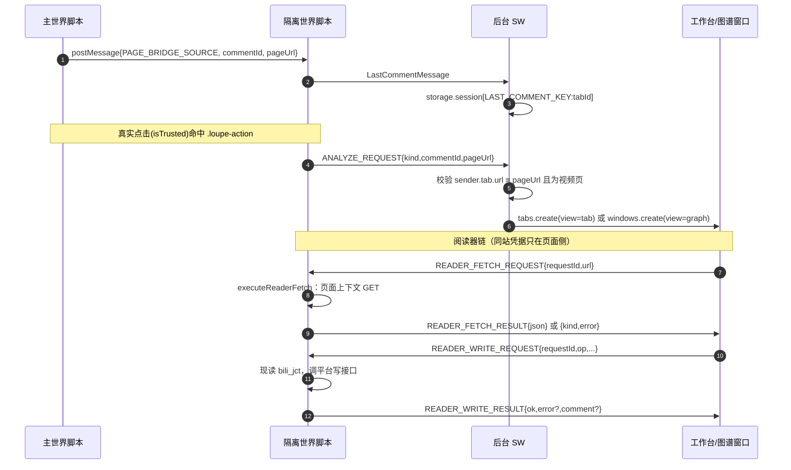
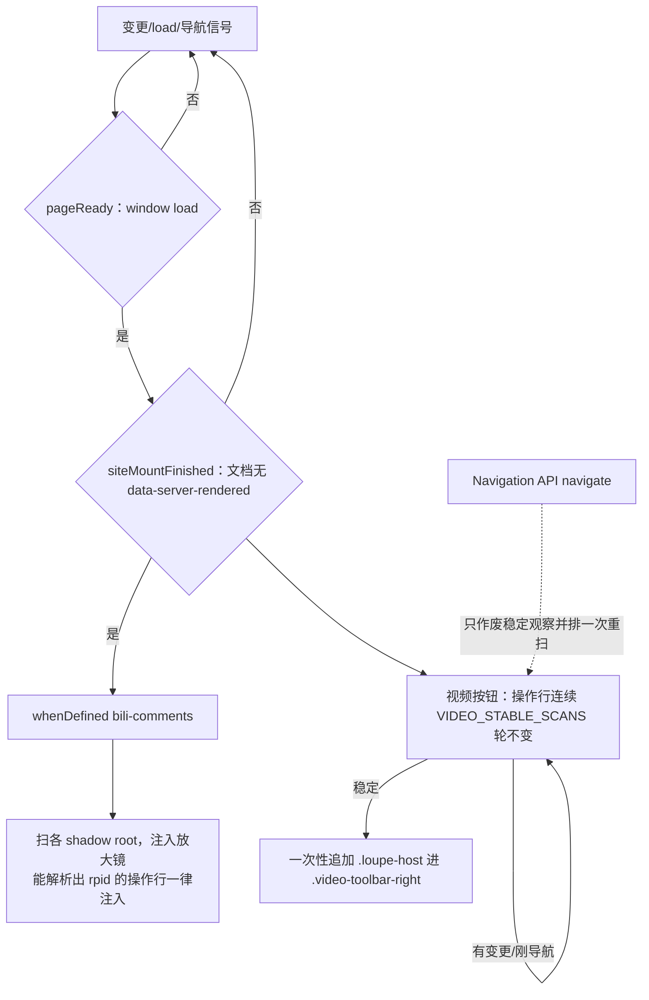

# 扩展宿主（L2 上下文）

> MV3 壳：清单、后台 Service Worker、以及 B 站视频页上主/隔离两套内容脚本；负责把分析入口送进页面、把评论区换成自绘阅读器，不做抓取、分析与渲染。

## 职责边界

**做**：清单生成（`manifest.ts`）；后台 DNR 会话规则、右键菜单、分析入口落地、按标签页暂存右键评论（`background.ts`）；页面按钮注入与评论组件数据解析（主世界：`content/main.ts` + `injector.ts` + `targets.ts`）；桥接 chrome.*、执行读/写、评论区替换（隔离世界：`content/isolated.ts` + `page-reader.ts` + `reader-reads.ts` + `reader-writes.ts`）。

**不做**：
- 不抓取 / 归一化 / 分析 / 渲染 —— 归 `src/core/**`、`src/platforms/**`、`src/ui/**`。
- 不保存登录 Cookie：读/写请求由浏览器在页面上下文自动带上（`content/reader-writes.ts:1-10`）。
- 不做通用 DOM 爬虫、不做定时全文档扫描：锚点只有评论组件操作行与播放器工具栏（`content/injector.ts:12-22`）。
- 不驱动原生样式增强：`native-comments-style.ts` / `native-thread.ts` / `native-thread-layout.ts` 保留但**未接线**；页面开关的唯一语义是「替换原生评论区」（`content/isolated.ts:9-11`、`content/main.ts:11-13`）。

## 对外接口

- `manifest.ts`：`createManifest(version: string): chrome.runtime.ManifestV3` —— 唯一真相，构建期求值成 `dist/manifest.json`。
- `messages.ts`：`isCommentId(v): v is string`（纯数字）、`isAnalyzeRequestMessage(v)`、`LOCATE_COMMENT` / `isLocateCommentRequest(v)` / `isLocateCommentResponse(v)`、`PAGE_BRIDGE_SOURCE`、`ANALYZE_REQUEST`、`LAST_COMMENT_KEY`、`ENSURE_HEADER_RULES`、`INTENT_KEY`。
- `page-comments.ts`：设置键 `PAGE_COMMENTS_ENABLED_KEY`；桥常量与守卫 `READER_*` / `isReader*` / `USER_CARD_BRIDGE_SOURCE` / `isUserCardBridgeMessage`；定位协议 `READER_LOCATE` / `isReaderLocateMessage` / `LOCATE_PENDING_KEY` / `isPendingLocate` / `videoIdOf(url): string | null`（从视频地址取 BV 号，后台挑标签页与内容脚本判身份共用）；`isExtensionContextInvalidated(error): boolean`。
- `content/user-card.ts`（主世界）：驱动**站点自己的**用户卡片元素 `bili-user-profile`（`setup(参考元素)` + 派发 `mouseenter`/`mouseleave`）。隔离世界拿不到站点那份自定义元素注册表，所以这一层必须在主世界；站点元素不在时整体放弃，不自绘卡片。见 [ADR-0005](../../docs/adr/0005-native-author-entries-via-site-component.md)。
- `url.ts`：`isVideoPageUrl(s): boolean`、`canonicalVideoUrl(s): string | null`（丢 hash 与 `comment_root_id`/`comment_secondary_id`，非视频页返回 null）。
- `open-panel.ts`：`openAnalysisTab({input,commentId?,windowId}): Promise<'tab'>`（`chrome.tabs.create`）、`openGraphPopup({input,commentId}): Promise<'popup'>`（图谱窗口，`view=graph`）、`openGraphPopupWindow(url, width?, height?): Promise<chrome.windows.Window | undefined>`——图谱弹窗**唯一**的 `windows.create` 实现（初值 960×660），开窗前用当前窗口 bounds 把窗口摆到中心（拿不到 bounds 就不传 left/top，回退浏览器默认，绝不抛错）；窗口挂载后由 `src/ui/views/GraphPopupView.vue#fitNow` 在 120/420/900ms 三拍**首帧就量**内容包围盒，仿真收敛后再由 `src/ui/views/GraphPopupView.vue#fitAfterSettle` 校准一次（clamp 到 720×560…1500×1100 与工作区、与上次写进窗口的尺寸相差 ≤8px 就不动窗口，用户动过就不再抢，只对 `type === 'popup'` 生效）。
- `permissions.ts`：`requestOriginPermission(url)` / `hasOriginPermission(url)`（可选主机权限，必须在点击手势的第一个 await 里发起）。
- `storage.ts`：`chromeSettingsStorage: SettingsStorage`（`chrome.storage.local`，AI 密钥只落这里）。
- `content/injector.ts`：`createPageActionInjector(doc): PageActionInjector`（`start/reconcile/dispose`）、`isOwnInsertion(record)`。
- `content/targets.ts`：`commentRpid(el)`、`commentTreeSize(el): number | null`、`contextCommentIdOf(el)`、`findVideoActionsAnchor(doc)`、`collectShadowRoots(node)`、`isOwnNode(node)`，以及选择器/类名/属性常量。
- `content/page-reader.ts`：`startPageReader(): void`（模块级单例，自带幂等与上下文失效熔断）。
- `content/reader-reads.ts` / `reader-writes.ts`：`createReaderFetchExecutor(http)` / `executeReaderFetch`、`createReaderWriteExecutor(adapter)` / `executeReaderWrite`；写意图 `ReaderWriteOp` = like/unlike/dislike/undislike/delete/reply（`page-comments.ts#isReaderWriteRequest`）；入参已过桥守卫，**不抛**，失败一律变成 `ok:false`。
- `content/native-comments-style.ts` / `native-thread.ts` / `native-thread-layout.ts`：`startNativeCommentStyler(doc,win)`、`createNativeThreadOrganizer(doc)`、`layoutThread(...)`/`MAX_THREAD_DEPTH`（未接线，保留能力）。

## 依赖关系

- 依赖 `../platforms` —— `manifest.ts` 取 `hostPermissions`，`background.ts` 取 `headerRewrites`（DNR 规则），`reader-writes.ts` 用 `bilibiliAdapter`。
- 依赖 `../core/errors`、`../core/http`、`../core/cache/memory` —— 读执行器复用平台错误枚举与传输层（页面上下文用内存缓存，绝不写页面源 IndexedDB）。
- 依赖 `@/ui/surface` —— `graphPopupUrl` 是 `view=graph` 地址契约的唯一实现（`open-panel.ts` 与页面阅读器共用）。
- 被依赖 `scripts/build.mjs` —— 经 `createManifest` 生成清单。
- 被依赖 `src/ui/` —— 嵌入页经 `EMBEDDED_CONTEXT` 向后台取规范地址，经 `READER_*` 桥与内容脚本通信。

## 关键决策（为何这样设计）

1. **主/隔离双世界**：评论数据只挂在自定义元素实例（`__data`/`.data`）上，只有主世界读得到；`chrome.*` 只有隔离世界可用（`manifest.ts:39-40`、`content/targets.ts:57-66`）。二者不共享 JS 堆，因此按钮由主世界写、点击由隔离世界在真实事件里转后台（`content/main.ts:1-10`）。
2. **写页面 DOM 等两道门**：`window load`（`pageReady`）**且**文档里再无 `data-server-rendered`（`siteMountFinished`）才写。水合前把宿主容器追加进 Vue 管理的 `.video-toolbar-right` 会让 hydration 失配 → 整棵 SSR DOM 被丢弃重建 → `bili-header` 二次 `init()` 同一个 `#biliMainHeader` → 顶部 header 变空。第二道门正是该实机事故的修复（`content/injector.ts:24-40, 84-86, 516-518`；同一判据复用于 `content/page-reader.ts:88-95, 286-291`）。
3. **稳定观察 `VIDEO_STABLE_SCANS = 2`**：站点分批渲染，一轮不足证明操作行停下；要求「同一元素 + 孩子数不变 + 无 childList 变更 + 无新导航信号」连续多轮（导航后额外 +1 轮）才挂按钮（`content/injector.ts:152-157, 425-462`）。
4. **导航用 Navigation API 而非补丁 history**：早期猴补丁 `history.pushState/replaceState` 实机把已挂载的全局 header 又 init 了一次。`history` 是站点路由与风控的公共契约，一个字节都不改；无 Navigation API 时退回 `popstate`/`hashchange`（`content/injector.ts:41-47, 549-580`）。
5. **只写原生评论根的 `display`**：保存原值精确还原，槽位是原生根的**相邻**兄弟（所以不必也不许隐藏祖先 `#commentapp`），页头 `#biliMainHeader` 与评论区任何祖先一概不碰（`content/page-reader.ts:9-20, 638-656`）。
6. **读/写都在页面上下文执行**：iframe 是扩展源，跨站请求带不上站点 Cookie，平台按匿名身份把小票截断（顶层评论约 315 条就停）；写请求还要求页面形态的 Origin。因此 iframe 只表达意图，执行在内容脚本（`content/reader-reads.ts:1-10`、`content/reader-writes.ts:1-10`）。
7. **DNR 规则限定 `initiatorDomains: [chrome.runtime.id]`**：只改写扩展自身页面发出的请求头，站点自己的请求一律不动，把扰动面锁在扩展内（`background.ts:49`）。
8. **评论行放大镜不按评论量判定**：主世界扫描原生评论操作行（`content/injector.ts#scanArea`），`commentRpid` 能解析出纯数字 id 就注入，评论数与回复数都不参与显隐；主世界读不到 `chrome.storage`，这里也就没有任何需要等设置就绪的默认值。

9. **定位协议：按视频身份投递 + 三层各自守边界**（[ADR-0008](../../docs/adr/0008-locate-in-reader.md)）：工作台/图谱发 `LOCATE_COMMENT` → 后台按 `videoIdOf(input)` 在已打开的 B 站视频标签页里挑一枚（`tabs.query` + 身份比对，host 权限已覆盖）、激活并 `tabs.sendMessage`；**没有已打开的就写 `LOCATE_PENDING_KEY`（`chrome.storage.local`，不是 `session`——它默认不对内容脚本开放）再新开标签页**，新页内容脚本挂载时身份一致才消费（读后即删）。内容脚本收下定位后必须回执（MV3 下不回执会让发送端以「message port closed」拒绝，把成功误报成失败），且 iframe 未就绪时先挂起、`READER_READY` 后补发。**它认视频身份，不认「你正看着的那一枚标签页」**：同视频多枚标签页时可能投给另一枚（真机踩到，见 `.context/LESSONS.md` L-13）。

## 图

## 已知限制与坑

- 站点改版即失效：锚点/选择器全按实机 shadow 结构复核，不匹配时静默不注入（`content/targets.ts:1-11, 28-41`）；不认 `#expander-contents` 这类易变 id（`content/native-thread.ts:26-30`）。
- 无 Navigation API 的回退里，pushState 型换页不产生事件，只靠新 DOM 触发重扫，最坏晚一拍（`content/injector.ts:565-580`）。
- 扩展被重载/更新后所有 `chrome.*` 作废：页面阅读器立刻熔断、还原并停止观察，否则每次 DOM 变更都重复抛错（`content/page-reader.ts:311-340`、`page-comments.ts:390-400`）。
- 就绪前不投递：iframe 文档还停在 `about:blank` 时带扩展源 targetOrigin 的 postMessage 会被丢弃；主题与可见范围在就绪时各重发一次（`content/page-reader.ts:22-27, 555-568`）。
- 读桥只放行 `https://api.bilibili.com` 的 https 地址、只 GET（请求类型里没有方法字段），请求头拒绝 cookie，响应头不跨桥（`page-comments.ts:249-305`）。
- 评论行放大镜只认能解析出纯数字 rpid 的原生操作行（`content/targets.ts#commentRpid`）：站点改版把组件数据换掉时静默不注入，不猜 id（`content/injector.ts#scanArea`）。
- **作者入口分两条路，各自最小**：点击走标准 `<a href=space.bilibili.com/<mid> target=_blank>`（零桥、零权限、与原生一致）；悬停卡片走 `READER_USER_CARD` → 隔离世界（校验 + 坐标换算）→ `USER_CARD_BRIDGE_SOURCE` → 主世界驱动站点元素。收起草稿**必须带 mid**（`hide` 带 mid 只关这一位；不带 mid 才是全局收起）——少了身份，迟到的收起会关掉已经换到别人身上的卡片，且守卫会直接丢掉那条消息（真机复现，见 `.context/LESSONS.md` L-12）。
- `READER_HEIGHT` / `READER_VIEWPORT` / `READER_THEME` / `READER_FETCH_REQUEST` / `READER_WRITE_RESULT` 语义正交，不可合并：高度驱动槽位尺寸（滚动条只剩宿主一根）、可见范围驱动按需分页、主题是宿主单向状态、读/写是带 `requestId` 的往返配对——合并会让「谁触发谁」的因果链在重连后无法重建（`page-comments.ts:84-115, 165-305`）。
- `native-comments-style` / `native-thread` 未接线，仅由各自测试与 `tmp/preview.ts` 使用（`content/isolated.ts:9-11`）。

## 相关

- `src/core/README.md`（引擎：抓取/缓存/游标分页）
- `docs/architecture/03-building-blocks.md`（构件与运行时、页面级设置、阅读器分页契约）
- `docs/architecture/02-goals-constraints.md`、`docs/adr/0001-single-extension-no-backend.md`
- `docs/adr/0003-reader-infinite-scroll.md`（游标状态机，阅读器触发/高度契约）
- 其它模块 README：`src/ui/README.md`、`tests/test-suite.md`
