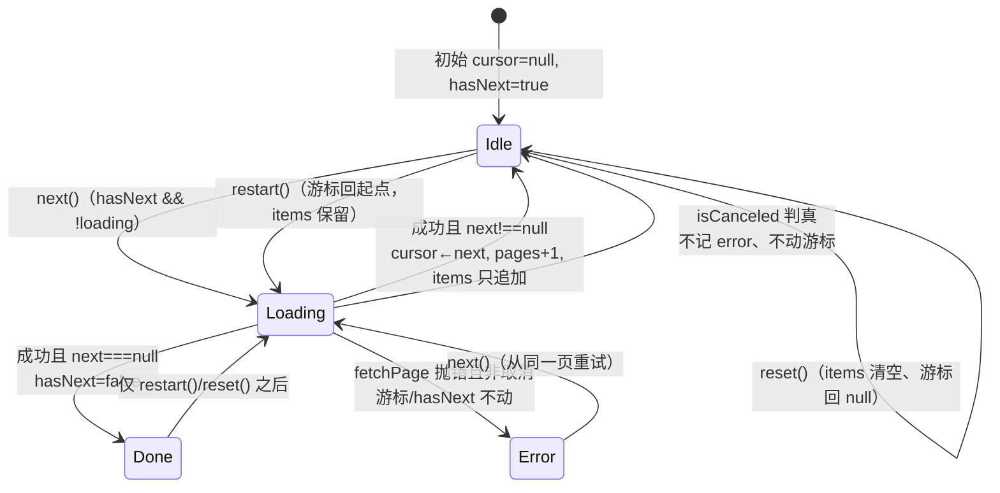
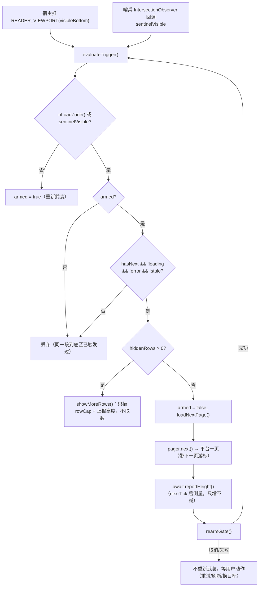

# UI 层（L2 上下文）

> Loupe 的全部界面：承载面路由、工作台状态、页面替换阅读器的取数/触发/高度纪律、设计令牌。

## 职责边界
- **做**：Vue 应用与响应式状态（`store.ts`）；承载面与 `?view=` 路由（`surface.ts`）；阅读器分页状态机 / 触发闸门 / 高度上报 / 写意图协议（`infinite-scroll.ts`、`EmbeddedComments.vue`、`reader-comments.ts`）；读取传输层的「桥优先 + 匿名回退」（`reader-http.ts`）；展示用树展平与虚拟列表（`thread.ts`、`virtual.ts`、`force-graph.ts`）；设计令牌（`styles/tokens.css`）。
- **不做**：平台请求 / 签名 / 响应校验 → `src/core/workbench.ts` + `src/platforms/`；缓存与快照持久化 → `src/core/cache/`；跨世界消息的**执行**（csrf 现读、页面上下文发请求、隐藏/还原原生评论区）→ `src/extension/` 内容脚本；AI 提示词与预算 → `src/ai/`。

## 对外接口
三个入口各自 `createApp(...).mount('#app')`，均无导出：`main.ts`→`App.vue`（`app.html`）、`embedded.ts`→`EmbeddedComments.vue`（`embedded.html`）、`config.ts`→`ConfigPopup.vue`（`config.html`，manifest `default_popup`）。

`surface.ts`
- `type Surface = 'panel' | 'tab' | 'graph'`
- `surfaceOf(params: URLSearchParams): Surface` —— 只认 `?view=tab|graph`，缺省/未知 → `'panel'`（surface.ts:8-13）
- `graphPopupUrl(appUrl: string, input: string, commentId: string): string` —— 拼 `?view=graph&input=&comment=`（surface.ts:16-22）

`store.ts`（模块级单例，视图只读写它）
- `state`（`reactive`）：`view / graphOnly / wide / input / session / run / subject / thread / history / options / insight / diagnosis / ai / notice`
- `init(): Promise<void>`、`describeError(error: unknown): string`、`resolveInput(raw): Resolved | null`（失败写 `state.inputError`）
- 抓取动作：`startSubject / refreshSubject / startThread / openComment / openSnapshot / deleteSnapshot / clearCache / loadSession / openLoginPage`；取消：`cancelRun / cancelAi`
- AI：`generateInsight / diagnoseThread`；偏好：`updateOptions(patch)`；意图：`applyIntent / consumeIntent / readStoredIntent`

`services.ts`：`cache`、`http`、`workbench`、`ai`、`readerHttp`（`createReaderHttp({ fallback: http })`）、`readerWorkbench`（`createMemoryCache()`）；`ensureHeaderRules(): Promise<void>`，失败抛 `Error`。

`infinite-scroll.ts`
- `interface CursorPage<T> { items: readonly T[]; next: string | null }`
- `type FetchPage<T> = (cursor: string | null) => Promise<CursorPage<T>>`（失败抛错，游标由状态机保留）
- `class CursorPager<T extends { id: string }>`：`state(): CursorPagerState<T>`、`subscribe(listener): () => void`、`next(): Promise<void>`、`reset(): void`、`restart(): void`、`get pagesLoaded: number`
- `CursorPagerOptions.isCanceled?(error: unknown): boolean` —— 判真即「中断不是失败」，不记 error、不动游标

`reader-comments.ts`：`likeIntent(commentId, liked) / replyIntent(comment, text) / commentIntent(text) / normalizeCommentText / commentTextError(text): string | null / buildWriteRequest(intent, requestId) / mergeComments(...sources): Comment[]`（reader-comments.ts:100-104）/ `createWriteClient(post, opts?): WriteClient`（`send` 永不 reject；`settle(result)`、`dropAll(reason)`）；常量 `NEW_COMMENT_KEY = '__new__'`、`WRITE_TIMEOUT_MS = 20_000`。

`reader-http.ts`：`PARENT_ORIGIN`、`READER_FETCH_TIMEOUT_MS = 15_000`、`createReaderHttp({ fallback, timeoutMs?, newId?, post? }): ReaderHttp`（`getJson` 桥优先、`postForm` 恒 reject `PlatformError('protocol')`）。

`theme.ts`（配色轴，见 [ADR-0007](../../docs/adr/0007-theme-palette-tokens.md)）：`PaletteId`/`PalettePref`、`PALETTE_KEY = 'loupe.palette'`、`PALETTES`（5 套预设 + label/swatch）、`PRESET_LIGHT_ACCENT`、`DEFAULT_PALETTE`、`normalizePalette(value)`（存储是不可信输入，非法一律回落青墨）、`applyPalette(pref)`（写 `html[data-palette]`，自定义写内联变量）、`loadPalette`/`savePalette`/`applyStoredPalette`、`watchPalette(cb): () => void`。三个入口（`main.ts`/`embedded.ts`/`config.ts`）都在 `app.mount` **之前** `applyStoredPalette()`。

其它纯逻辑：`thread.ts`（`ThreadRow`、`flattenThread`、`MAX_VISUAL_DEPTH = 3`、`collapsibleIds`、`ROW_PAGE_SIZE = 100`、`nextRowCap(cap, total)`、`COMPACT_ROW_THRESHOLD`；`ThreadRow` 除 `node/id/depth/index/hasChildren/folded/hidden/preview` 外还带几何三元组 `col`（视觉列 = `min(depth, MAX_VISUAL_DEPTH)`）/`parentCol`/`rowSpines`）、`virtual.ts`（`computeWindow`、`scrollTopForIndex`）、`force-graph.ts`（`buildGraph / seedPositions / highlightOf / fitTransform / pickNode / nodeRadius`）、`prefs.ts`（`loadCrawlOptions / saveCrawlOptions`，键 `loupe.crawlOptions`）、`explore.ts`、`format.ts`、`markdown.ts`、`comment-text.ts`。

## 依赖关系
- 依赖：`@/core/workbench`（抓取/快照门面）、`@/core/report`+`@/core/model`（类型）、`@/core/tree`（`buildForest`）、`@/platforms`+`@/ai`+`@/core/cache`+`@/core/http`（仅 `services.ts` 装配）、`@/extension/page-comments`（跨世界契约与守卫）、`@/extension/messages`（意图、`ensureHeaderRules`）。
- 被依赖：`src/extension/open-panel.ts:9,55` 用 `graphPopupUrl` 开图谱窗口；`src/extension/content/page-reader.ts` 挂 `embedded.html` 并收发 `READER_*` 消息；`src/extension/background.ts:180-183` 校验 `embedded.html` 来源。

## 关键决策（为何这样设计）
1. **承载面判定只有一处**：`store` 与嵌入阅读器共用 `surface.ts` 的 `view=graph` 契约，后台与页面不各写一份字符串（surface.ts:2-3）。
2. **图谱窗口不参与意图分发**：它的目标由 URL 的 `input/comment` 驱动；若也消费 `storage.session` 的意图，会把本该在整页打开的分析抢走（store.ts:408-409,420）。
3. **取数状态机不知道渲染上限**：`rowCap`/`hiddenRows` 只活在视图里（EmbeddedComments.vue#rowCap、EmbeddedComments.vue#listRows），状态机只认游标（infinite-scroll.ts:1-9）。渲染上限挡住行时先 `showMoreRows()` 只长高、不取数（EmbeddedComments.vue#showMoreRows），取数留给真正的列表末尾。
4. **「到底」只认平台游标**：`hasNext = next !== null`（infinite-scroll.ts:148）；不用「请求 N 条拿到更少」推断——它分不清「到头」与「被上限/登录态截断」（infinite-scroll.ts:5-8）。见 [ADR-0003](../../docs/adr/0003-reader-infinite-scroll.md)。
5. **失败保留游标、只追加**：失败只写 `error`，游标与 `hasNext` 不动（infinite-scroll.ts:153-154）；`commit` 新 id 追加、同 id 覆盖原位（infinite-scroll.ts:165-174），列表长度单调不减。
6. **边沿触发而非「每条视口消息都试一次」**：宿主在滚动/尺寸变化/每次高度上报后都推视口消息，`armed` 保证同一段到底区只取一次（EmbeddedComments.vue#armed、EmbeddedComments.vue#evaluateTrigger）。
7. **已提交高度不缩**：`reportHeight(allowShrink)` 只在「确认变大」或结构性缩高事件（折叠切换、换目标/重置）时下调（EmbeddedComments.vue#reportHeight），否则宿主文档变矮 → 浏览器把 `scrollTop` 钳回（回弹根因，EmbeddedComments.vue#committedHeight）。
8. **哨兵只是兜底**：跨源 iframe 里 `rootMargin` 被忽略、`rootBounds` 为 null，提前量用 `translateY(-LOAD_MORE_MARGIN)` 做进哨兵自身几何（EmbeddedComments.vue#sentinelEl），回调交付不稳定故视口通道必须可用（EmbeddedComments.vue#observeSentinel）。
9. **读走桥、写只发意图**：iframe 是扩展源、直连带不上站点 Cookie（匿名约 315 条封顶），故读经 `READER_FETCH_REQUEST` 在页面上下文执行；只有「投递不出去/没回话」才降级直连，内容脚本照实回投的网络错误仍交给上游退避（reader-http.ts:11-19,117-126）。
10. **阅读器缓存只在内存**：session 键没有账号维度，与工作台共用磁盘缓存会互相喂错身份；阅读器不落快照，故不丢已有行为（services.ts:20-31）。
11. **阅读器不做虚拟化**：长正文按自然高度完整呈现，大树靠「分批渲染 + 折叠」限流（thread.ts:63-64）；定高虚拟列表只给工作台的 `VirtualList` 用。
12. **顶层顺序 = 取回顺序（渲染层只追加）**：平台按时间**倒序**分页（`api.ts#fetchRootPage` 的 `mode=2`），而 `tree.ts#buildForest` 按 `createdAt` **升序**排根——直接用 `forest.roots` 渲染会让每一页新行整块插到已读内容之上（视口不动、内容下移一页高，观感即「加载新评论被打回刚看过的位置」）。改为按 `mergeComments` 的取回顺序取 `forest.byId`（EmbeddedComments.vue#merged、EmbeddedComments.vue#roots），森林只负责层级；父评论缺失的孤儿按森林顺序补末尾。见 [ADR-0004](../../docs/adr/0004-reader-row-order-append-only.md)。
13. **换目标才重置**：`READER_NAVIGATION` 由后台对**任何** `tabs.onUpdated.url` 变化发出（含站点自己的 `replaceState`），所以先按目标身份比对（EmbeddedComments.vue#identityOf）再决定是否 `resetTarget()`（EmbeddedComments.vue#onNavigation）；否则一次 URL 抖动就会丢掉全部已读页并把槽位高度打回 360px（宿主文档变矮 → `scrollTop` 被钳回）。见 ADR-0003 的 2026-10-14 补充。
14. **渲染分批与取数状态解耦**：`evaluateTrigger()` 先铺开已取回的行、再考虑取数（EmbeddedComments.vue#evaluateTrigger 里 `hiddenRows` 分支在游标判断之前）；到底（平台不再给游标）立刻一次铺开剩余行（EmbeddedComments.vue#revealAllRows）。反过来写就会出现「中途滚到底自动铺开、到底之后却要手动点『继续显示 N 条』」这种不一致。`nextRowCap()` 同时改成**只增不减**（`listRows = rows.slice(0, cap)`，上限一缩就把已铺开的尾部行移出 DOM）。
15. **加载指示用既有图标组件并保持行高**：`~icons/ph/circle-notch` + `.spinner`（内联 SVG、动效与 `prefers-reduced-motion` 策略全在 `base.css`）。不要再写零尺寸的空 ``——`.spinner` 只有动画没有几何，那种占位是**看不见**的。头部那处承担文字职责，所以带 `role="img"` + `aria-label`/`title`；状态行里旁边已有阶段文案的用 `aria-hidden`。
16. **作者入口复刻原生，不自绘**：作者模型带 `Author.profileUrl`（适配器归一化时给出），阅读器把头像与昵称渲染成 `<a target="_blank">`（点击开主页，与原生一致；平台没给地址就降级成 `span`，见 PageCommentRow.vue#userEntryTag）；悬停只报「谁 + 在哪」（PageCommentRow.vue#hoverUser → EmbeddedComments.vue#onUserCard → 内容脚本换算坐标 → 主世界驱动站点自己的 `bili-user-profile`）。**卡片内容/样式/关注私信/「指针移到卡片上保持打开」全是站点实现**，我们只驱动。见 [ADR-0005](../../docs/adr/0005-native-author-entries-via-site-component.md)。
17. **完整度要能解释「为什么只有这几条」**：`RootsPage.limitations`（`core/report.ts`）随页带回平台的身份限制（未登录截断等），进 `completeness.reasons`（EmbeddedComments.vue#completeness），只在「声明数未知或没读满」时挂上——读满就不冒充「不完整」。

18. **连接线锚在头像几何中心，脊线由纯逻辑算好**：列中心 `Xc(k) = --indent-base + k × --step + --slot-center`（`--slot-center` = 头像槽半宽），竖脊/stem/elbow/capped 的每一条 `left` 都由它推导（`PageCommentRow.vue#comment-row`）；`flattenThread` 输出 `col`/`parentCol`/`rowSpines`，渲染层不再按深度猜「这根线到谁为止」。同辈非末位节点的 `parentCol` 必须穿透本行与它的全部后代——这正是旧版「悬空半截线/缺一条线」的根因。视觉列封顶 `MAX_VISUAL_DEPTH = 3`，封顶行（`col === parentCol`）不画 elbow、改画竖直连接段（`.line.capped`），深度语义由「第 N 层」提示补回。见 [ADR-0006](../../docs/adr/0006-reader-spine-geometry.md)。
19. **动效走既有令牌，不新造一套**：`--ease-spring`/`--dur-micro/fast/dock` 已有；点赞弹簧、计数回弹（挂载首帧不播）、`row-flash` 定位闪烁、回复抽屉的 `grid-template-rows: 0fr → 1fr`（不测高）。**不做**楼中楼分支的 grid 折叠抽屉：阅读器是扁平分批列表，折叠 = 从行集里移除（ADR-0003/0004 的「只追加 + 已提交高度不缩」契约），把折叠中的子树留在 DOM 里会与高度上报和渲染上限打架，收益只有一个 260ms 的动画。回复抽屉同理：**壳常驻**（轨道过渡要有起止两端），**Composer 只在打开时挂载**（上千行各挂一个 textarea 是白付的内存）。
20. **配色是与明暗正交的一条轴**：`data-palette` 属性选择器（5 套预设，浅色/系统深色/显式深色三个入口）+ 自定义走内联变量；只覆盖 accent 系五个令牌（`--accent`/`--accent-strong`/`--accent-bg`/`--accent-border`/`--selection-bg`），中性色阶与语义色不动。切换入口是共用组件 `components/PalettePicker.vue`（自己读写 `loupe.palette`，所以挂两处天然同步），挂在**工具栏设置弹窗**（`ConfigPopup.vue`，主入口）与工作台顶栏（`TopBar.vue`）；阅读器是另一个文档：挂载时应用一次 + `watchPalette` 跟随（实测设置弹窗/工作台里点色点，已打开的 B 站页阅读器即时换色，无需刷新）。见 [ADR-0007](../../docs/adr/0007-theme-palette-tokens.md)。
21. **定位协议：三个 hop，定位语义在阅读器**：工作台/图谱 → 后台（按**视频身份**挑标签页、激活、转发；没有已打开的就写 `LOCATE_PENDING_KEY` 再新开）→ 内容脚本（校验身份、就绪前挂起、`READER_READY` 后补发）→ 阅读器 `EmbeddedComments.vue#locateComment`（展开祖先折叠 → 抬渲染上限 → `scrollIntoView` 居中 + `flash-highlight`）。**不在已读范围就照实提示**，不造行、不滚到别的行。行元素因此写上 `data-comment-id`（定位锚点）。闪烁类必须在 `await nextTick()` **之后**挂——行上的 `class` 是绑定，Vue 下一次 patch 会重写整个 class 属性，先挂会被抹掉。见 [ADR-0008](../../docs/adr/0008-locate-in-reader.md)。

22. **原型视觉细节对齐（第二批，2026-10-14）**：UP 作者头像用 `--accent-bg`/`--accent-strong` 着色；正文「回复 @某人：」前缀由 `comment-text.ts#splitMention` 解析出 mention（正文去前缀、单独成 pill）——解析只发生在 `PageCommentRow` 的渲染这一处，`thread.ts#preview`／详情卡／AI 仍用原始文本；首屏加载用 `components/SkeletonRows.vue` + `base.css` 的 `.skeleton-shimmer-box`（高度低于真实首屏，卸载后由只增不减的 `reportHeight()` 兜底）；工作台四块浮岛错峰入场（`island-drop/slide-left/slide-right/rise`，0/50/90/120ms）+ 视图切换 `view-fade-in/slide-forward/slide-backward` + 详情卡换选重放 `detail-reveal`（凡重放都要摘类→强制重排→挂类）；图谱选中/聚焦节点画 `force-graph.ts#radarPing` 驱动的雷达波（只在有选中/聚焦时开 rAF，`prefers-reduced-motion` 画静态环）。**有意不做的两项**：阅读器内的筛选/排序条（排序会与 ADR-0004「行序 = 取回顺序」正面冲突，且阅读器只持有已滚过的那几页，客户端排序/过滤会重排或藏掉正在读的行；等价能力在工作台 `views/ExplorerView.vue` + `explore.ts`，那里数据是全量）——**用户 2026-10-14 已把「还原原生按最热｜最新排序」追加为独立目标**（见 `roadmap.md` 的「大模块更新」第 4 条：走服务端排序 / 只在数据集完整的视图里排，仍不做客户端重排）、楼中楼分支的 grid 折叠抽屉（ADR-0006 决策 6）。

23. **第三批（2026-10-14，按实机反馈）**：① **「全部折叠」是意图而不是一次性动作**——`foldAll()` 置 `foldAllActive`，新取回的页 / 新写成的评论里**新出现**的可折叠 id 由 `watch(forest)` 并进 `collapsed`（不重算整份集合，所以用户随后单行展开不会被折回去），`expandAll()` 才收掉这个意图。② **自绘行的「图谱」入口不按评论量判定**：原生评论行与自绘行的入口都不受评论数量控制；自绘行的入口总是渲染、默认 `opacity: 0`，鼠标悬停该行或该行被选中才在**行右端**显形（`PageCommentRow.vue` 的 `.analyze` 段），不占版面、也不与操作行其余按钮抢宽度。③ **图谱弹窗**：开窗收口到 `open-panel.ts#openGraphPopupWindow`（初值 **960×660**、以当前窗口中心摆位）；窗口挂载后**首帧就量**内容包围盒（`src/ui/views/GraphPopupView.vue#fitNow`，`EARLY_FIT_AT_MS` = 120/420/900ms，不等仿真收敛），仿真收敛后再由 `src/ui/views/GraphPopupView.vue#fitAfterSettle` 校准一次；目标尺寸 clamp 到 720×560…1500×1100 与屏幕工作区，与上次写进窗口的尺寸相差 ≤8px 就不动窗口，用户自己拖过/改过（`onBoundsChanged`）就彻底不抢。工作台标签页不受影响。④ **图谱雷达波只闪两下**：`force-graph.ts#radarPing` 返回 `done`，`ForceGraph` 播满两个周期就停 rAF（静态选中描边保留），选中/聚焦变化与**每次适配视图**（`fitView`，含工具栏按钮、键盘 0/f、自动适配、resize）各重播一次；`prefers-reduced-motion` 下画静态环。⑤ **顶部运行/提示条改浮层**：`.topstack > .status` 绝对定位挂在顶栏下方（`width: max-content`，自身随文案长短变高变矮），抓取进度文本变长变短不再把中段那一排（左 rail / 画布 / 右侧详情）整排顶下去（`App.vue`）。⑥ **两侧浮岛按内容自适应高度**：`.dock` 与 `.detail-panel` 改成 `align-self: start` + `max-height: 100%`，默认就只有内容那么高，长内容分别由 `.dock-scroll` / `.detail-scroll` 内部滚动，不再一进界面就贯通整段中段。⑦ **嵌入阅读器不自绘底色**：`src/ui/embedded.html` 与阅读器根元素都透明（主题仍由宿主经 `READER_THEME` 推来），B 站评论区自己的底色直接透上来，浅色/深色与站点同色；头部工具组（`.bar-tools`）加 `margin-left: auto`，头部换行时仍贴右，右边缘与头部右边缘对齐。
24. **卸载钩子里访问 `chrome.*` 一律 `try/catch`**：`onBeforeUnmount` 可能跑在扩展上下文已失效之后（真实环境是扩展重载 / 页面卸载，单测里是 `afterEach` 先 `unstubAllGlobals` 再自动卸载），那时读 `chrome.storage` 会抛 `ReferenceError`，而它只会变成控制台噪音——`theme.ts#watchPalette` 返回的退订函数就按这条写（它也是阅读器卸载路径上唯一的 `chrome.*` 调用）。

25. **第四、五批：浮岛形态、面板瘦身与位置稳定（2026-10-14，按实机反馈 + 一轮外部设计评审）**：
   ⓪ **位置稳定优先于「居中好看」**：左侧 rail 的六个 tab 与右侧详情把手都**锚在顶边**（`.rail { align-self: flex-start; justify-content: flex-start }`、`.detail-panel.collapsed { align-self: start }`）。面板是按内容自适应高度的，居中会让这组图标/把手随面板高度上下平移；锚顶后展开只往下长，实测四种状态（AI 收起/展开、历史、左栏收起、详情展开）下 rail 的 tab 顶边恒为 101/161/220/280/340/399、详情与把手的顶边恒为 92——切换时一个像素都不动。
   ① **收起详情 = 竖向胶囊书签**：`.detail-panel.collapsed` 自己不再画玻璃（原先是「方板 + 内层把手」两层壳），材质整体让给 `.detail-handle`：32×104、仅左侧圆角、`color-mix(surface 92%)` + `blur(18px)` + `--deck-shadow-side`，贴右缘、顶边与展开态对齐（见 ⓪）；hover 左移 4px、文字转 `--accent`，`:active` 轻微回弹。竖排两字用「flex 纵向一列一个字符」而不是 `writing-mode: vertical-rl`（行距字重更好控）。`prefers-reduced-motion` 下单独取消位移——base.css 的全局降级只压时长，改不到「位置变了」本身。
   ② **左侧面板：标题栏压实一档**（13px 标题、`padding-bottom: var(--sp-1)`），面板高度即内容高度（见决策 23 ⑥），长内容在 `.dock-scroll` 内部滚动。
   ③ **「输入」面板只留三块**：输入行（含两个分析入口）→ 一句隐私提示（`用当前登录态抓取，数据只留本机`，替代原来整块「快速开始」卡片；原卡片那句「怎么用」与输入框 placeholder、按钮文案重复，属删掉不会让人做错事的文案）→ **默认收起的「抓取选项」`
`**（摘要行右侧实时显示「刷新方式 · 上限」，文案与面板共用 `prefs.ts` 的 `REFRESH_MODE_LABELS` / `limitsSummary`；摘要窄了宁可截断也不把名字压成两行：`.disclosure-title { flex: none }` + 摘要 `text-overflow: ellipsis`）→ 最近快照。抓取选项本体改成两列紧凑网格（刷新方式占整行、两个上限并排），解释一律进 `title`。
   ④ **「自绘评论区」开关从工作台删掉**（`components/PageReadingSwitch.vue` 已删除）：该设置的唯一入口是工具栏设置弹窗（`ConfigPopup.vue`），同一个开关出现在两处只会让「哪边是准的」变成问题。
   ⑤ **`base.css` 新增 `.switch` 原语**：直接贴在 `<input type="checkbox">` 上（`appearance: none` 自绘轨道 + `::after` 滑块，不额外包 DOM），关 = `--surface-3` 轨道 + `--border-strong` 描边，开 = `--accent` 轨道 + `--fg-on-accent` 滑块，滑块动效走 `--ease-spring`；设置弹窗的布尔项用它，**同一组可多选**的仍用 `.checkbox`。
   ⑥ **顶栏参数行居中**：`.params` 加 `justify-content: center`——顶栏浮岛宽度由最宽的那一行（品牌/标题行）决定，参数行比它短时否则会整行偏左。
   ⑦ **面板里不再「卡片套卡片」**（第五批：AI 与历史两个 tab 与「输入」tab 同一套语言）：每个 tab 只有一层 `.stack`，分节用 `section-head`/`section-title`（13px + 一条 `--border` 细线，比 `card-title` 再轻一档），空状态一律**一行左对齐**（`--fs-sm` + `--fg-subtle`），不再居中成段。列表类内容（历史快照、最近快照）改**细分隔线的列表行**（`border-bottom` + hover `--surface-2`），不再一行一个 `--surface-2` 盒子。AI 设置与「抓取选项」同款：低频块默认收成一行 `
` 摘要（`AI 设置 [未授权] 模型名`，「AI 解读」的开关也收在里面，用 `base.css` 的 `.switch`）；摘要宽度只有 ~110px，所以停用时只写「未启用」，完整型号进 `title`。

## 图

### 分页状态机（`CursorPager`）

### 一次「滚到底 → 追加一页 → 高度上报」

## 已知限制与坑
- `panel` 承载面已无入口：侧栏链路被移除（`src/extension/open-panel.ts:5`），只有手开 `app.html`（不带 `?view=`）才命中；`surfaceOf` 的缺省分支是保守回退而非真实路径（surface.ts:7-13）。
- `state.wide` 注释写「CSS 走两栏布局」，但当前唯一消费者是 `intentSurface`（store.ts:410），模板里没人用它 —— 注释与实现不同步。
- `PARENT_ORIGIN` 在 `location.ancestorOrigins` 缺失时退化为 `'*'`（reader-http.ts:27），此时入站校验只剩 `source === window.parent`（EmbeddedComments.vue#onParentMessage）。
- 哨兵 IO 回调在部分环境不总交付（ADR-0003「遗留」），触发正确性不能只依赖它（EmbeddedComments.vue#observeSentinel）。
- `bridgeDown` 是单向闩：一次「桥不可用」之后本页所有读都走匿名直连，直到页面重载（reader-http.ts:65,123）。
- 高度上报是单值幂等：`height === committedHeight` 直接返回（EmbeddedComments.vue#reportHeight），「同一高度但内容换了」不会重新告知宿主；[INFERENCE] 槽位高度不变，观感无影响。
- `virtual.ts` 的定高窗口只服务工作台（`VirtualList` ← `ThreadCanvas`/`CommentList`），阅读器路径完全不用它（thread.ts:63-64）。
- **页脚仍会被追加内容推下**：`.more` 在列表末尾，追加一页时它下移（真机实测单次 layout-shift ≤0.023，且只在取数落定帧可见——触发点比它进视口早约 480px，见 `LOAD_MORE_MARGIN`）。ADR-0003 要求「到底态用文案而不是控件消失」，所以不采用「删掉页脚」这条通用建议。
- **阅读器挂载首帧有一次 0.026 的微移**：`恢复原版评论` 按钮/`bar-tools` 从 16px 落到 46px（首屏状态条切换）。与无限滚动无关，属 `roadmap.md` 的「加载与空/错误态」待办。
- **用户卡片依赖站点内部实现**：元素名 `bili-user-profile`、`setup(参考元素)`、参考元素的 `data-user-profile-id` 缺任一条，悬停卡片就静默不出现（点击开主页不受影响）。探针只能验证「站点元素不存在时安静地什么都不做」。
- **卡片锚在宿主视口坐标上**：宿主一滚就与头像对不上，因此滚动 / 指针移出槽位 / 槽位被拆时内容脚本做全局收起（`page-reader.ts#dismissUserCard`）。站点自己的迷你播放器遮罩（`div.bili-mini-mask`，z-index 10010）会吞掉整页指针事件——那时阅读器与原生评论区一样不可交互，属站点行为。
- **行锚点 `data-comment-id`（2026-10-14 起有了）**：`PageCommentRow` 的根 `<article class="comment-row">` 现在带 `data-comment-id`，定位协议与外部探针都用它认行。在这之前它没有 DOM id，探针只能靠「行文本哈希」认行——行内文本一变（例如迟到的楼中楼结果改写了行内计数）会被误判成「出现新行」（真机实测出现过一次假 `insertedAbove=1`）。

- **定位按「视频身份」投递，不认「你正看着的那一枚标签页」**：同一个视频开着多枚标签页时，后台按 URL 挑中的可能是另一枚（真机实测踩到：目标页毫无反应，因为消息投给了另一枚同 URL 的标签页）。工作台侧的按钮只在「结果属于 bilibili 视频」时出现；图谱窗口没有评论区语义，不出现。
- **定位只认「已读到的评论」**：阅读器按滚动逐页取顶层评论，目标深在后面的页里时会提示「不在已读范围内——滚到底把它所在的那一页取回来后再试」（不做全量抓取，见 ADR-0003）。

## 相关
- [ADR-0003 阅读器无限滚动契约](../../docs/adr/0003-reader-infinite-scroll.md)
- [ADR-0004 阅读器行序：渲染层只追加](../../docs/adr/0004-reader-row-order-append-only.md)
- [docs/architecture/03-building-blocks.md](../../docs/architecture/03-building-blocks.md)（界面 / 图谱 / 阅读器的整体切分）
- 兄弟模块 README：`../extension/README.md`、`../core/README.md`、`../../tests/test-suite.md`
